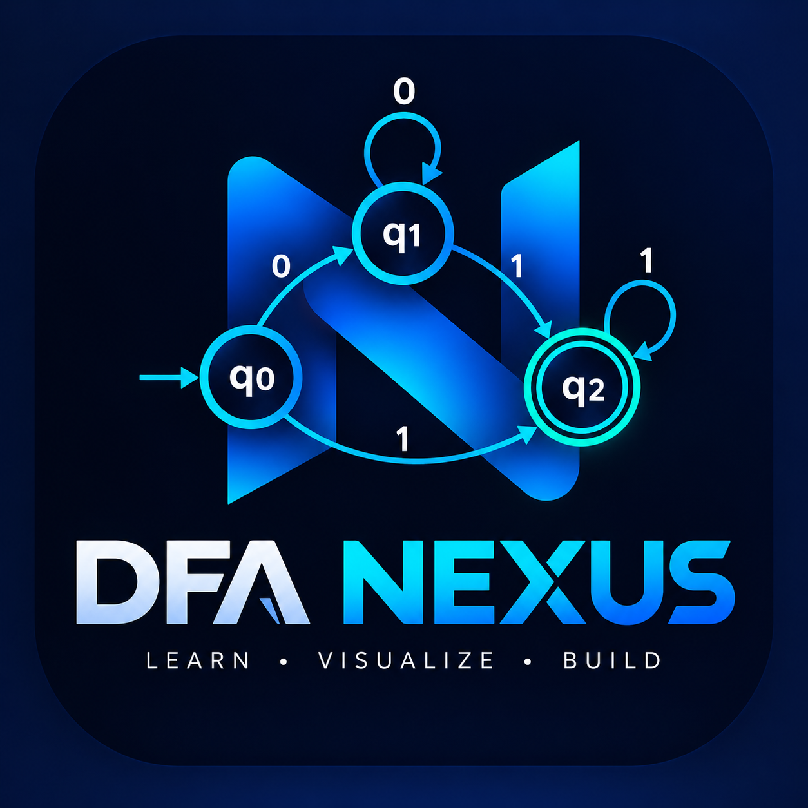

<div align="center">



<br/>

# ⚡ DFA NEXUS

### THE DFA UNION ENGINE

**Learn • Visualize • Build**

An Interactive Platform for Exploring Deterministic Finite Automata

<br/>

<a href="https://dfanexus-iem57c9h.manus.space">
  
</a>

<br/><br/>


<br/><br/>

**Turning Automata Theory into an Interactive Learning Experience.**

</div>

---

## 📑 Table of Contents

- [🌟 Project Overview](#-project-overview)
- [🎯 Objectives](#-objectives)
- [✨ Core Features](#-core-features)
- [🏗️ System Architecture](#️-system-architecture)
- [🔄 Working Workflow](#-working-workflow)
- [🧠 Mathematical Foundation](#-mathematical-foundation)
- [🌳 Product State Tree Map](#-product-state-tree-map)
- [🧪 Illustrative Example](#-illustrative-example)
- [📊 Complexity Analysis](#-complexity-analysis)
- [💻 Technology Stack](#-technology-stack)
- [🚀 Getting Started](#-getting-started)
- [🎓 Learning Outcomes](#-learning-outcomes)
- [🛣️ Future Roadmap](#️-future-roadmap)
- [🤝 Contributing](#-contributing)
- [📜 License](#-license)
- [🔗 Project Links](#-project-links)

---

# 🌟 Project Overview

**DFA Nexus** is an educational web application designed to make the concepts of Deterministic Finite Automata (DFA) and regular-language operations easier to understand.

In Theory of Computation, combining two automata requires understanding their states, transition functions, initial states, and accepting conditions.

DFA Nexus focuses on making these concepts easier to explore through an application-oriented learning experience.

The central mathematical operation is the **union of two regular languages**, constructed using the cross-product method.

The objective is to connect theoretical concepts with practical understanding.

<div align="center">

### TWO AUTOMATA
### ↓
### CROSS-PRODUCT CONSTRUCTION
### ↓
### ONE UNION AUTOMATON

</div>

## 🎯 Objectives

- Simplify the learning of deterministic finite automata.
- Demonstrate the construction of a union automaton.
- Explain product states and transition functions.
- Illustrate accepting-state conditions.
- Support students studying Theory of Computation.
- Encourage practical exploration of regular languages.

---

# ✨ Core Features

<table>
<tr>
<td width="50%" valign="top">

### 🧩 DFA Union Construction

Understand how two DFAs can be combined into an automaton representing the union of their languages.

</td>
<td width="50%" valign="top">

### 🔄 Cross-Product Method

Explore how pairs of states from two automata form the states of a product automaton.

</td>
</tr>
<tr>
<td width="50%" valign="top">

### 🔤 Regular Language Exploration

Learn how regular languages can be represented and analyzed using finite automata.

</td>
<td width="50%" valign="top">

### 🎯 Accepting-State Logic

Understand how accepting states are determined using the union condition.

</td>
</tr>
<tr>
<td width="50%" valign="top">

### 🔗 Transition Analysis

Study how input symbols determine transitions between product states.

</td>
<td width="50%" valign="top">

### 📚 Interactive Learning

Explore automata theory through a practical application instead of relying only on mathematical explanations.

</td>
</tr>
</table>

> Note: The live application is the source of truth for currently implemented features. Verify individual features before describing them as fully operational.

---

# 🏗️ System Architecture

The following diagram illustrates the conceptual architecture of a DFA union application.

```text
                    ┌─────────────────────────┐
                    │       DFA NEXUS         │
                    │   Learning Application  │
                    └────────────┬────────────┘
                                 │
                    ┌────────────▼────────────┐
                    │      User Interface     │
                    │   Input and Results     │
                    └────────────┬────────────┘
                                 │
                ┌────────────────┴────────────────┐
                │                                 │
       ┌────────▼────────┐               ┌────────▼────────┐
       │     DFA M1      │               │     DFA M2      │
       │                 │               │                 │
       │ State Set Q1    │               │ State Set Q2    │
       │ Alphabet Σ      │               │ Alphabet Σ      │
       │ Transition δ1   │               │ Transition δ2   │
       │ Final Set F1    │               │ Final Set F2    │
       └────────┬────────┘               └────────┬────────┘
                │                                 │
                └────────────────┬────────────────┘
                                 │
                    ┌────────────▼────────────┐
                    │  Product Construction  │
                    │                         │
                    │  Pair States            │
                    │  Combine Transitions    │
                    │  Apply Union Condition  │
                    └────────────┬────────────┘
                                 │
                    ┌────────────▼────────────┐
                    │      Resulting DFA      │
                    │                         │
                    │       Q = Q1 × Q2       │
                    │       L = L1 ∪ L2       │
                    └─────────────────────────┘
